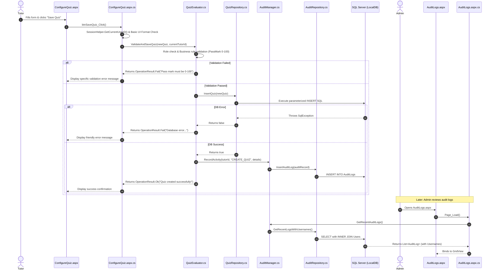

# CodeLab Contribution & Architectural Guidelines

> **Project Model**: CodeLab is structured as an **ASP.NET Web Site Project (WSP)**.
> - Shared classes live in `App_Code/` and are dynamically compiled at runtime by the ASP.NET runtime.
> - Pages (`.aspx`), User Controls (`.ascx`), and Master Pages (`.Master`) have paired `.cs` (Code-Behind) files without `.designer.cs` overhead.
> - *Note for Visual Studio*: If your team ever converts this to a Web Application Project (WAP), remember that files in `App_Code` will require their **Build Action** set to `Compile` or should be moved to root-level folders with `.designer.cs` files.

---

## Architecture Diagram

```text
CodeLab/
│
├── App_Data/
│   ├── Database.mdf          # Local SQL Server Express / LocalDB file (Ignored in .gitignore)
│   ├── Schema.sql            # DDL script to create tables, keys, and constraints
│   └── Seed.sql              # Initial seed data for development & testing
│
├── App_Code/                 # Shared application layers (Auto-compiled)
│   ├── BLL/                  # Business Logic Layer (The "Brain")
│   │   ├── CourseManager.cs
│   │   ├── QuizEvaluator.cs
│   │   ├── AuditManager.cs
│   │   └── LeaderboardManager.cs
│   ├── DAL/                  # Data Access Layer (Strictly SQL connectivity)
│   │   ├── DatabaseHelper.cs
│   │   ├── QuizRepository.cs
│   │   ├── AuditRepository.cs
│   │   └── LeaderboardRepository.cs
│   ├── Helpers/              # Cross-cutting static utilities (No SQL!)
│   │   ├── SessionHelper.cs
│   │   └── LogHelper.cs
│   └── Models/               # Plain Old CLR Objects (POCOs) & DTOs
│       ├── User.cs
│       ├── Quiz.cs
│       ├── AuditLog.cs
│       └── OperationResult.cs
│
├── Assets/                   # Static client-side assets
│   ├── CSS/
│   ├── JS/
│   └── Images/
│
├── Modules/                  # Presentation Layer (Organized by role)
│   ├── Admin/
│   │   ├── Dashboard.aspx / Dashboard.aspx.cs
│   │   ├── AuditLogs.aspx / AuditLogs.aspx.cs
│   │   └── Web.config        # Role lockdown (Admin only)
│   ├── Learner/
│   │   ├── CodeLab.aspx / CodeLab.aspx.cs
│   │   └── Web.config        # Role lockdown (Learner, Tutor, Admin)
│   ├── Tutor/
│   │   ├── ConfigureQuiz.aspx / ConfigureQuiz.aspx.cs
│   │   └── Web.config        # Role lockdown (Tutor, Admin)
│   └── Public/
│       ├── Login.aspx / Login.aspx.cs
│       └── Register.aspx / Register.aspx.cs
│
├── UserControls/             # Reusable UI components
│   ├── LeaderboardWidget.ascx
│   └── LeaderboardWidget.ascx.cs
│
├── Site.Master
├── Site.Master.cs
└── Web.config                # Global configuration & authentication rules
```

---

## Database Versioning & Git Strategy

> [!WARNING]
> **Do NOT commit binary `Database.mdf` and `Database_log.ldf` to Git!**
> Binary database files lead to merge conflicts, repository bloat, and file locks across teammate machines.
> Keep `*.mdf` and `*.ldf` in your `.gitignore`. Instead, version [Schema.sql](file:///d:/ASP Workspace/CodeLab/App_Data/Schema.sql) and [Seed.sql](file:///d:/ASP Workspace/CodeLab/App_Data/Seed.sql) in `App_Data/`. Each team member runs these scripts in LocalDB or SQL Server Express to stand up their own clean local database instance.

---

## Folder Responsibilities & Strict Layering Rules

### 1. `App_Code/Models/` (Data Transfer Objects & POCOs)
Plain C# classes that represent domain entities and operation results. They carry structured data across layers without containing SQL or business rules.
* `Quiz.cs`: Properties such as `QuizID`, `Title`, `PassMark`, `CreatedByUserID`, `CreatedAt`.
* `AuditLog.cs`: Properties such as `LogID`, `UserID`, `Username`, `FullName`, `Action`, `Details`, `Timestamp`.
* `OperationResult.cs`: Standardized result object with `Success` (bool) and `Message` (string) so the BLL can communicate why an operation passed or failed back to the UI.

### 2. `App_Code/DAL/` (Data Access Layer)
**Strict Rule: All SQL queries, `SqlConnection`, `SqlCommand`, and `SqlDataReader` reside exclusively here.**
* Files like `QuizRepository.cs`, `AuditRepository.cs`, and `LeaderboardRepository.cs`.
* Always use parameterized queries via `command.Parameters.Add("@Name", SqlDbType.Type).Value = ...` to prevent SQL injection and avoid type-inference pitfalls.
* **No UI code, redirects, or session checks belong here.**

### 3. `App_Code/BLL/` (Business Logic Layer)
**Strict Rule: The brain of the application. No raw SQL queries and no UI server controls.**
* Files like `QuizEvaluator.cs`, `AuditManager.cs`, and `LeaderboardManager.cs`.
* Validates domain rules (e.g., `PassMark` between 0 and 100), performs defense-in-depth role authorization checks, coordinates transactions, and calls the DAL.
* Returns rich `OperationResult` or typed model objects instead of ambiguous booleans.

### 4. `App_Code/Helpers/` (Cross-Cutting Utilities)
**Strict Rule: Pure utility functions only. Absolutely NO SQL statements.**
* `SessionHelper.cs`: Encapsulates session access (e.g., `SessionHelper.GetCurrentUserID()`, `SessionHelper.IsUserInRole("Admin")`) to prevent string-key typos and null reference exceptions.
* `LogHelper.cs`: Captures unhandled technical exceptions (diagnostic file logging or `System.Diagnostics.Trace`) so system errors are logged without exposing raw exceptions to end users.

### 5. `Modules/` (Presentation Layer)
Organized by role to match user access boundaries:
* `.aspx` files contain HTML5, ASP.NET server controls, and client scripts.
* `.aspx.cs` (Code-Behind) files collect user input, validate basic form formats, call the BLL, and bind result messages to the UI. **Never write SQL in code-behind.**

### 6. `UserControls/` (Reusable Widgets)
Reusable UI blocks like `LeaderboardWidget.ascx`.
* Code-behind `LeaderboardWidget.ascx.cs` must call the BLL (`LeaderboardManager.cs`), **never the DAL directly**.

---

## Authentication & Role-Based Authorization

To prevent unauthorized users (e.g., a Learner navigating directly to `/Modules/Admin/AuditLogs.aspx`), security is enforced at three distinct boundaries:

### 1. Declarative Authorization in Folder-Level `Web.config`
Each protected subfolder in `Modules/` contains its own scoped `Web.config`:

```xml
<!-- Modules/Admin/Web.config -->
<configuration>
  <system.web>
    <authorization>
      <allow roles="Admin" />
      <deny users="*" />
    </authorization>
  </system.web>
</configuration>
```

```xml
<!-- Modules/Tutor/Web.config -->
<configuration>
  <system.web>
    <authorization>
      <allow roles="Tutor,Admin" />
      <deny users="*" />
    </authorization>
  </system.web>
</configuration>
```

### 2. Defense-in-Depth in the Business Logic Layer
UI and page-level checks alone are not enough. BLL methods verify that the calling user possesses the required permissions before mutating any records:

```csharp
if (!SessionHelper.IsUserInRole(currentUserId, "Tutor") && !SessionHelper.IsUserInRole(currentUserId, "Admin"))
{
    return OperationResult.Fail("Unauthorized: You do not have permission to configure quizzes.");
}
```

---

## Example Flow: A Tutor Creates a New Quiz (Full Architecture & Audit Trail)

This flow illustrates the complete end-to-end lifecycle adhering to every architectural rule:



### Step 1: The Model Definitions

```csharp
// App_Code/Models/OperationResult.cs
public class OperationResult
{
    public bool Success { get; set; }
    public string Message { get; set; }

    public static OperationResult Ok(string message = "") => new OperationResult { Success = true, Message = message };
    public static OperationResult Fail(string message) => new OperationResult { Success = false, Message = message };
}

// App_Code/Models/Quiz.cs
public class Quiz
{
    public int QuizID { get; set; }
    public string Title { get; set; }
    public int PassMark { get; set; }
    public int CreatedByUserID { get; set; }
    public DateTime CreatedAt { get; set; }
}

// App_Code/Models/AuditLog.cs
public class AuditLog
{
    public int LogID { get; set; }
    public int UserID { get; set; }
    public string Username { get; set; }
    public string FullName { get; set; }
    public string Action { get; set; }
    public string Details { get; set; }
    public DateTime Timestamp { get; set; }
}
```

### Step 2: The User Interface (`Modules/Tutor/ConfigureQuiz.aspx`)

```html
<asp:TextBox ID="txtQuizTitle" runat="server" CssClass="form-control" placeholder="Quiz Title" />
<asp:TextBox ID="txtPassMark" runat="server" CssClass="form-control" TextMode="Number" placeholder="Pass Mark (0 - 100)" />
<asp:Button ID="btnSaveQuiz" runat="server" Text="Save Quiz" CssClass="btn btn-primary" OnClick="btnSaveQuiz_Click" />
<asp:Label ID="lblMessage" runat="server" CssClass="alert" Visible="false" />
```

### Step 3: The Code-Behind (`Modules/Tutor/ConfigureQuiz.aspx.cs`)

```csharp
protected void btnSaveQuiz_Click(object sender, EventArgs eventArgs)
{
    // 1. Session verification
    int currentTutorId = SessionHelper.GetCurrentUserID();
    if (currentTutorId <= 0)
    {
        Response.Redirect("~/Modules/Public/Login.aspx");
        return;
    }

    // 2. Safe format parsing
    if (string.IsNullOrWhiteSpace(txtQuizTitle.Text) || !int.TryParse(txtPassMark.Text, out int passMarkValue))
    {
        lblMessage.Text = "Please enter a valid title and numeric pass mark.";
        lblMessage.CssClass = "alert alert-warning";
        lblMessage.Visible = true;
        return;
    }

    Quiz newQuiz = new Quiz
    {
        Title = txtQuizTitle.Text.Trim(),
        PassMark = passMarkValue,
        CreatedByUserID = currentTutorId,
        CreatedAt = DateTime.UtcNow
    };

    // 3. Delegate to Business Logic Layer
    QuizEvaluator evaluator = new QuizEvaluator();
    OperationResult result = evaluator.ValidateAndSaveQuiz(newQuiz, currentTutorId);

    // 4. Present specific feedback from the BLL
    lblMessage.Text = result.Message;
    lblMessage.CssClass = result.Success ? "alert alert-success" : "alert alert-danger";
    lblMessage.Visible = true;
}
```

### Step 4: The Business Logic Layer (`App_Code/BLL/QuizEvaluator.cs`)

```csharp
public class QuizEvaluator
{
    public OperationResult ValidateAndSaveQuiz(Quiz quizData, int performedByUserId)
    {
        // 1. Defense-in-depth: authorization check
        if (!SessionHelper.IsUserInRole(performedByUserId, "Tutor") && !SessionHelper.IsUserInRole(performedByUserId, "Admin"))
        {
            return OperationResult.Fail("Unauthorized: You do not have permission to create quizzes.");
        }

        // 2. Business validation rules
        if (string.IsNullOrWhiteSpace(quizData.Title))
        {
            return OperationResult.Fail("Quiz title is required.");
        }

        if (quizData.PassMark < 0 || quizData.PassMark > 100)
        {
            return OperationResult.Fail("Pass mark must be between 0% and 100%.");
        }

        // 3. Persist via DAL
        QuizRepository quizRepository = new QuizRepository();
        bool isInserted = quizRepository.InsertQuiz(quizData);

        if (!isInserted)
        {
            return OperationResult.Fail("A system error occurred while saving the quiz to the database. Please try again.");
        }

        // 4. Log business activity via AuditManager (BLL -> DAL)
        AuditManager auditManager = new AuditManager();
        auditManager.RecordActivity(
            performedByUserId, 
            "CREATE_QUIZ", 
            $"Created quiz '{quizData.Title}' with pass mark {quizData.PassMark}%."
        );

        return OperationResult.Ok("Quiz created successfully!");
    }
}
```

### Step 5: The Data Access Layer (`App_Code/DAL/QuizRepository.cs`)

```csharp
public class QuizRepository
{
    public bool InsertQuiz(Quiz quizData)
    {
        string query = @"INSERT INTO Quizzes (Title, PassMark, CreatedByUserID, CreatedAt) 
                         VALUES (@Title, @PassMark, @CreatedByUserID, @CreatedAt)";

        try
        {
            using (SqlConnection connection = DatabaseHelper.GetConnection())
            {
                using (SqlCommand command = new SqlCommand(query, connection))
                {
                    // Explicit SqlDbType parameters to prevent type-inference quirks
                    command.Parameters.Add("@Title", SqlDbType.NVarChar, 150).Value = quizData.Title;
                    command.Parameters.Add("@PassMark", SqlDbType.Int).Value = quizData.PassMark;
                    command.Parameters.Add("@CreatedByUserID", SqlDbType.Int).Value = quizData.CreatedByUserID;
                    command.Parameters.Add("@CreatedAt", SqlDbType.DateTime2).Value = quizData.CreatedAt;

                    connection.Open();
                    int rowsAffected = command.ExecuteNonQuery();
                    return rowsAffected > 0;
                }
            }
        }
        catch (SqlException sqlException)
        {
            // Log technical failure for diagnostics without leaking details to UI
            LogHelper.LogError("QuizRepository.InsertQuiz SQL failure", sqlException);
            return false;
        }
    }
}
```

### Step 6: Audit Layering (`App_Code/BLL/AuditManager.cs` & `App_Code/DAL/AuditRepository.cs`)

```csharp
// App_Code/BLL/AuditManager.cs (Business Logic)
public class AuditManager
{
    private readonly AuditRepository _auditRepository = new AuditRepository();

    public void RecordActivity(int userId, string action, string details)
    {
        AuditLog log = new AuditLog
        {
            UserID = userId,
            Action = action,
            Details = details,
            Timestamp = DateTime.UtcNow
        };

        _auditRepository.InsertAuditLog(log);
    }

    public List<AuditLog> GetRecentAuditLogs()
    {
        return _auditRepository.GetRecentLogsWithUsernames();
    }
}

// App_Code/DAL/AuditRepository.cs (Data Access)
public class AuditRepository
{
    public bool InsertAuditLog(AuditLog auditRecord)
    {
        string query = @"INSERT INTO AuditLogs (UserID, Action, Details, Timestamp) 
                         VALUES (@UserID, @Action, @Details, @Timestamp)";
        try
        {
            using (SqlConnection connection = DatabaseHelper.GetConnection())
            {
                using (SqlCommand command = new SqlCommand(query, connection))
                {
                    command.Parameters.Add("@UserID", SqlDbType.Int).Value = auditRecord.UserID;
                    command.Parameters.Add("@Action", SqlDbType.VarChar, 50).Value = auditRecord.Action;
                    command.Parameters.Add("@Details", SqlDbType.NVarChar, 500).Value = auditRecord.Details;
                    command.Parameters.Add("@Timestamp", SqlDbType.DateTime2).Value = auditRecord.Timestamp;

                    connection.Open();
                    return command.ExecuteNonQuery() > 0;
                }
            }
        }
        catch (SqlException sqlException)
        {
            LogHelper.LogError("AuditRepository.InsertAuditLog failure", sqlException);
            return false;
        }
    }

    public List<AuditLog> GetRecentLogsWithUsernames()
    {
        List<AuditLog> logList = new List<AuditLog>();
        string query = @"SELECT TOP 100 
                            a.LogID, a.UserID, u.Username, u.FullName, a.Action, a.Details, a.Timestamp 
                         FROM AuditLogs a
                         INNER JOIN Users u ON a.UserID = u.UserID
                         ORDER BY a.Timestamp DESC";

        using (SqlConnection connection = DatabaseHelper.GetConnection())
        {
            using (SqlCommand command = new SqlCommand(query, connection))
            {
                connection.Open();
                using (SqlDataReader reader = command.ExecuteReader())
                {
                    while (reader.Read())
                    {
                        logList.Add(new AuditLog
                        {
                            LogID = Convert.ToInt32(reader["LogID"]),
                            UserID = Convert.ToInt32(reader["UserID"]),
                            Username = reader["Username"].ToString(),
                            FullName = reader["FullName"].ToString(),
                            Action = reader["Action"].ToString(),
                            Details = reader["Details"].ToString(),
                            Timestamp = Convert.ToDateTime(reader["Timestamp"])
                        });
                    }
                }
            }
        }
        return logList;
    }
}
```

### Step 7: The Admin Audit Viewer (`Modules/Admin/AuditLogs.aspx.cs`)

Notice how `AuditLogs.aspx.cs` routes cleanly through `AuditManager` in the BLL instead of querying the DAL or helpers directly:

```csharp
protected void Page_Load(object sender, EventArgs eventArgs)
{
    if (!IsPostBack)
    {
        AuditManager auditManager = new AuditManager();
        List<AuditLog> auditLogs = auditManager.GetRecentAuditLogs();

        gvAuditLogs.DataSource = auditLogs;
        gvAuditLogs.DataBind();
    }
}
```

---

## Architectural Best Practices & Coursework Tips

> [!TIP]
> **Atomic Transactions (`SqlTransaction`)**:
> If your project rubric expects strict atomicity (e.g., creating a quiz and recording the audit log must either both succeed or both rollback), open a `SqlTransaction` in the repository or wrap the operation in a `System.Transactions.TransactionScope`.

> [!TIP]
> **Testability & Interfaces**:
> To make your BLL unit-testable without requiring a live database connection, define interfaces (e.g., `IQuizRepository`, `IAuditRepository`) in `App_Code/DAL/`. Inject these interfaces into BLL class constructors so mock repositories can be passed during automated testing.
