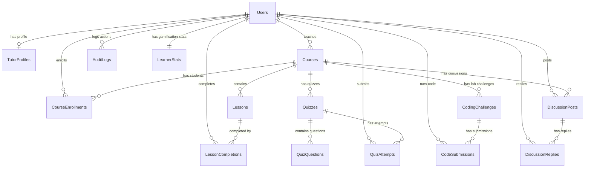

# CodeLab — Visual Studio Database Schema (SQL Server / LocalDB)
**Target Environment:** Visual Studio Built-in Database (SQL Server LocalDB / `.mdf` / SQL Server Express)  
**Compatibility:** Visual Studio 2019 / 2022, SQL Server Object Explorer, Entity Framework Core / LINQ to SQL  
**Standard:** Clean, Normalized Relational Schema (Optimized for Simplicity and Reliability)

---

## 1. Is the Enterprise Schema Too Complex?

**Yes!** The enterprise version was designed for Coursera-scale multi-region cloud infrastructure (with table partitioning, materialized views, trigram text indexing, and Row-Level Security). 

For **Visual Studio's built-in database (SQL Server LocalDB)**, you do **not** need:
- ❌ No complex table partitioning or sharding.
- ❌ No complicated materialized views or cron refresh scripts.
- ❌ No custom PostgreSQL extensions or obscure JSONB indexes.
- ❌ No low-level Row-Level Security policies.

Instead, you need a **clean, practical schema** using standard SQL Server types (`INT IDENTITY`, `NVARCHAR`, `BIT`, `DATETIME2`) that:
1. Can be executed directly in **Visual Studio Query Editor** in a single click.
2. Generates seamlessly into **Entity Framework (EF Core)** models or **LINQ to SQL / ADO.NET**.
3. Perfectly mirrors everything in your CodeLab app without unnecessary bloat.

---

## 2. Visual Studio ERD Diagram



---

## 3. Visual Studio Ready T-SQL Script (Copy & Paste)

You can copy and run this entire script directly inside **Visual Studio**:
> **In Visual Studio:** Go to `View` -> `SQL Server Object Explorer` -> Right-click your database -> Click `New Query...` -> Paste and click **Execute (Ctrl + Shift + E)**.

```sql
-- ============================================================================
-- CODELAB DATABASE SCHEMA FOR VISUAL STUDIO (SQL SERVER / LOCALDB)
-- ============================================================================

-- 1. USERS & AUTHENTICATION
CREATE TABLE Users (
    Id INT IDENTITY(1,1) PRIMARY KEY,
    FullName NVARCHAR(120) NOT NULL,
    Username NVARCHAR(50) NOT NULL UNIQUE,
    Email NVARCHAR(255) NOT NULL UNIQUE,
    PasswordHash NVARCHAR(255) NOT NULL,
    Role NVARCHAR(20) NOT NULL DEFAULT 'Learner' 
        CONSTRAINT CHK_User_Role CHECK (Role IN ('Learner', 'Tutor', 'Admin')),
    Status NVARCHAR(20) NOT NULL DEFAULT 'Active' 
        CONSTRAINT CHK_User_Status CHECK (Status IN ('Active', 'Suspended', 'Pending')),
    AvatarUrl NVARCHAR(500) NULL,
    JoinedDate DATETIME2 NOT NULL DEFAULT GETDATE(),
    LastLogin DATETIME2 NULL
);

-- 2. TUTOR PROFILES (Details for instructors)
CREATE TABLE TutorProfiles (
    UserId INT PRIMARY KEY FOREIGN KEY REFERENCES Users(Id) ON DELETE CASCADE,
    Qualifications NVARCHAR(MAX) NOT NULL,
    PortfolioUrl NVARCHAR(500) NOT NULL,
    Bio NVARCHAR(MAX) NOT NULL,
    Specialty NVARCHAR(100) NOT NULL,
    Status NVARCHAR(20) NOT NULL DEFAULT 'Approved' 
        CONSTRAINT CHK_Tutor_Status CHECK (Status IN ('Approved', 'Pending', 'Rejected')),
    ApprovedDate DATETIME2 NULL
);

-- 3. COURSES
CREATE TABLE Courses (
    Id INT IDENTITY(1,1) PRIMARY KEY,
    Title NVARCHAR(200) NOT NULL,
    Description NVARCHAR(MAX) NOT NULL,
    Category NVARCHAR(80) NOT NULL, -- e.g., 'Web Development', 'Python', 'Algorithms'
    Difficulty NVARCHAR(20) NOT NULL DEFAULT 'Beginner' 
        CONSTRAINT CHK_Course_Difficulty CHECK (Difficulty IN ('Beginner', 'Intermediate', 'Advanced')),
    InstructorId INT NOT NULL FOREIGN KEY REFERENCES Users(Id),
    Status NVARCHAR(20) NOT NULL DEFAULT 'Published' 
        CONSTRAINT CHK_Course_Status CHECK (Status IN ('Draft', 'Pending Review', 'Published', 'Locked')),
    ThumbnailUrl NVARCHAR(500) NULL,
    LockReason NVARCHAR(500) NULL,
    RejectionReason NVARCHAR(500) NULL,
    MaterialsDescription NVARCHAR(MAX) NULL,
    CreatedAt DATETIME2 NOT NULL DEFAULT GETDATE(),
    UpdatedAt DATETIME2 NOT NULL DEFAULT GETDATE()
);

-- 4. LESSONS (Course content & code snippet previews)
CREATE TABLE Lessons (
    Id INT IDENTITY(1,1) PRIMARY KEY,
    CourseId INT NOT NULL FOREIGN KEY REFERENCES Courses(Id) ON DELETE CASCADE,
    Title NVARCHAR(200) NOT NULL,
    Content NVARCHAR(MAX) NOT NULL, -- Lesson notes or instructions
    CodeSnippet NVARCHAR(MAX) NULL, -- Example code snippet
    CodeLanguage NVARCHAR(50) NULL DEFAULT 'javascript',
    ThumbnailUrl NVARCHAR(500) NULL,
    VideoUrl NVARCHAR(500) NULL,
    OrderIndex INT NOT NULL DEFAULT 1,
    DurationMinutes INT NOT NULL DEFAULT 15,
    CreatedAt DATETIME2 NOT NULL DEFAULT GETDATE()
);

-- 5. COURSE ENROLLMENTS
CREATE TABLE CourseEnrollments (
    Id INT IDENTITY(1,1) PRIMARY KEY,
    LearnerId INT NOT NULL FOREIGN KEY REFERENCES Users(Id),
    CourseId INT NOT NULL FOREIGN KEY REFERENCES Courses(Id) ON DELETE CASCADE,
    EnrolledAt DATETIME2 NOT NULL DEFAULT GETDATE(),
    ProgressPercent DECIMAL(5,2) NOT NULL DEFAULT 0.00,
    IsCompleted BIT NOT NULL DEFAULT 0,
    CompletedAt DATETIME2 NULL,
    CONSTRAINT UQ_Enrollment UNIQUE (LearnerId, CourseId)
);

-- 6. LESSON COMPLETIONS (Checkmarks for completed lessons)
CREATE TABLE LessonCompletions (
    LearnerId INT NOT NULL FOREIGN KEY REFERENCES Users(Id),
    LessonId INT NOT NULL FOREIGN KEY REFERENCES Lessons(Id) ON DELETE CASCADE,
    CompletedAt DATETIME2 NOT NULL DEFAULT GETDATE(),
    PRIMARY KEY (LearnerId, LessonId)
);

-- 7. QUIZZES (Matches Quiz.cs & QuizRepository.cs)
CREATE TABLE Quizzes (
    Id INT IDENTITY(1,1) PRIMARY KEY,
    CourseId INT NULL FOREIGN KEY REFERENCES Courses(Id) ON DELETE SET NULL,
    Title NVARCHAR(150) NOT NULL,
    PassMark INT NOT NULL DEFAULT 80 
        CONSTRAINT CHK_Quiz_PassMark CHECK (PassMark BETWEEN 0 AND 100),
    CreatedByUserId INT NOT NULL FOREIGN KEY REFERENCES Users(Id),
    Instructions NVARCHAR(MAX) NULL,
    CreatedAt DATETIME2 NOT NULL DEFAULT GETDATE()
);

-- 8. QUIZ QUESTIONS & CHOICES
CREATE TABLE QuizQuestions (
    Id INT IDENTITY(1,1) PRIMARY KEY,
    QuizId INT NOT NULL FOREIGN KEY REFERENCES Quizzes(Id) ON DELETE CASCADE,
    QuestionText NVARCHAR(MAX) NOT NULL,
    QuestionType NVARCHAR(30) NOT NULL DEFAULT 'Multiple Choice'
        CONSTRAINT CHK_QuizQuestion_Type CHECK (QuestionType IN ('Multiple Choice', 'True-False')),
    OptionsJson NVARCHAR(MAX) NOT NULL, -- Stored as JSON array: '["Option A", "Option B", "Option C"]'
    CorrectOptionIndex INT NOT NULL DEFAULT 0,
    Explanation NVARCHAR(MAX) NOT NULL,
    OrderIndex INT NOT NULL DEFAULT 1
);

-- 9. QUIZ ATTEMPTS & SCORES
CREATE TABLE QuizAttempts (
    Id INT IDENTITY(1,1) PRIMARY KEY,
    LearnerId INT NOT NULL FOREIGN KEY REFERENCES Users(Id),
    QuizId INT NOT NULL FOREIGN KEY REFERENCES Quizzes(Id) ON DELETE CASCADE,
    ScorePercent INT NOT NULL,
    Passed BIT NOT NULL,
    TotalQuestions INT NOT NULL,
    CorrectCount INT NOT NULL,
    AttemptedAt DATETIME2 NOT NULL DEFAULT GETDATE()
);

-- 10. INTERACTIVE CODING CHALLENGES (Code Lab)
CREATE TABLE CodingChallenges (
    Id INT IDENTITY(1,1) PRIMARY KEY,
    CourseId INT NOT NULL FOREIGN KEY REFERENCES Courses(Id) ON DELETE CASCADE,
    Title NVARCHAR(200) NOT NULL,
    Description NVARCHAR(MAX) NOT NULL,
    Difficulty NVARCHAR(20) NOT NULL DEFAULT 'Beginner'
        CONSTRAINT CHK_Challenge_Difficulty CHECK (Difficulty IN ('Beginner', 'Intermediate', 'Advanced')),
    Language NVARCHAR(50) NOT NULL DEFAULT 'javascript',
    StarterCode NVARCHAR(MAX) NOT NULL,
    ExpectedOutput NVARCHAR(MAX) NOT NULL,
    PointsReward INT NOT NULL DEFAULT 50,
    CreatedAt DATETIME2 NOT NULL DEFAULT GETDATE()
);

-- 11. CODE SUBMISSIONS (Execution history)
CREATE TABLE CodeSubmissions (
    Id INT IDENTITY(1,1) PRIMARY KEY,
    LearnerId INT NOT NULL FOREIGN KEY REFERENCES Users(Id),
    ChallengeId INT NOT NULL FOREIGN KEY REFERENCES CodingChallenges(Id) ON DELETE CASCADE,
    SubmittedCode NVARCHAR(MAX) NOT NULL,
    Status NVARCHAR(30) NOT NULL 
        CONSTRAINT CHK_Submission_Status CHECK (Status IN ('Passed', 'Failed', 'Error')),
    OutputResult NVARCHAR(MAX) NULL,
    SubmittedAt DATETIME2 NOT NULL DEFAULT GETDATE()
);

-- 12. LEARNER STATS & GAMIFICATION (XP, Levels, Streaks)
CREATE TABLE LearnerStats (
    LearnerId INT PRIMARY KEY FOREIGN KEY REFERENCES Users(Id) ON DELETE CASCADE,
    AchievementPoints INT NOT NULL DEFAULT 0,
    CurrentLevel INT NOT NULL DEFAULT 1,
    LevelTitle NVARCHAR(50) NOT NULL DEFAULT 'Novice Coder',
    NextMilestonePoints INT NOT NULL DEFAULT 500,
    StreakDays INT NOT NULL DEFAULT 1,
    LastActiveDate DATE NOT NULL DEFAULT CAST(GETDATE() AS DATE)
);

-- 13. COMMUNITY FORUM POSTS
CREATE TABLE DiscussionPosts (
    Id INT IDENTITY(1,1) PRIMARY KEY,
    CourseId INT NOT NULL FOREIGN KEY REFERENCES Courses(Id) ON DELETE CASCADE,
    AuthorId INT NOT NULL FOREIGN KEY REFERENCES Users(Id),
    Title NVARCHAR(250) NOT NULL,
    Content NVARCHAR(MAX) NOT NULL,
    CreatedAt DATETIME2 NOT NULL DEFAULT GETDATE()
);

-- 14. COMMUNITY FORUM REPLIES
CREATE TABLE DiscussionReplies (
    Id INT IDENTITY(1,1) PRIMARY KEY,
    PostId INT NOT NULL FOREIGN KEY REFERENCES DiscussionPosts(Id) ON DELETE CASCADE,
    AuthorId INT NOT NULL FOREIGN KEY REFERENCES Users(Id),
    Content NVARCHAR(MAX) NOT NULL,
    CreatedAt DATETIME2 NOT NULL DEFAULT GETDATE()
);

-- 15. AUDIT & ACTIVITY LOGS (Matches AuditLog.cs & AuditRepository.cs)
CREATE TABLE AuditLogs (
    Id INT IDENTITY(1,1) PRIMARY KEY,
    UserId INT NOT NULL FOREIGN KEY REFERENCES Users(Id),
    Action VARCHAR(50) NOT NULL, -- e.g. 'CREATE_QUIZ', 'LOGIN', 'LOCK_COURSE'
    Details NVARCHAR(500) NULL,
    Timestamp DATETIME2 NOT NULL DEFAULT GETDATE()
);
```

---

## 4. Key Improvements for Visual Studio Beginners

| Feature | Enterprise Version (Overkill) | Visual Studio Version (Recommended) | Why This is Better |
| :--- | :--- | :--- | :--- |
| **Primary Keys** | `UUIDv7` with custom binary generators | `INT IDENTITY(1,1)` | Auto-increments effortlessly (1, 2, 3...) in Visual Studio and Entity Framework. |
| **Enum Fields** | PostgreSQL `CREATE TYPE ... AS ENUM` | `NVARCHAR + CHECK (...)` | SQL Server does not have an `ENUM` keyword. `CHECK` constraints provide identical strict validation without syntax errors. |
| **Data Types** | `JSONB`, `INET`, `TIMESTAMPTZ`, custom ENUMs | `NVARCHAR`, `INT`, `BIT`, `DATETIME2` | 100% native SQL Server types that won't give compile errors or mapping errors. |
| **Relations** | Complex cascading & partition range trees | Standard `FOREIGN KEY ... ON DELETE CASCADE` | When you delete a course, its lessons and quizzes are automatically cleaned up. |
| **Options Storage** | 3 separate relational join tables for choices | `OptionsJson` in question or simple index | Simple to read and write without writing 5-table JOIN queries. |
| **Leaderboard** | Materialized view with cron jobs | Query directly with `ORDER BY AchievementPoints DESC` | Visual Studio LocalDB can return the top 100 learners in milliseconds without background jobs. |

### 4.1 Why doesn't SQL Server / Visual Studio use `ENUM`?

In MySQL or PostgreSQL, you might write `Role ENUM('Learner', 'Tutor', 'Admin')`. 

However, **Microsoft SQL Server (T-SQL) has never had an `ENUM` keyword.** If you attempt to run:
```sql
-- ❌ THIS WILL FAIL IN VISUAL STUDIO / SQL SERVER:
Role ENUM('Learner', 'Tutor', 'Admin') 
-- Msg 156, Level 15: Incorrect syntax near the keyword 'ENUM'.
```

#### How SQL Server accomplishes ENUM behavior:
The official, industry-standard approach in SQL Server is to use a **`CHECK` Constraint**:
```sql
-- ✅ THE SQL SERVER STANDARD (USED IN THIS SCHEMA):
Role NVARCHAR(20) NOT NULL CONSTRAINT CHK_User_Role CHECK (Role IN ('Learner', 'Tutor', 'Admin'))
```
**Benefits:**
1. **Identical strict validation:** If anyone tries to insert `'Student'` or a typo like `'lerner'`, SQL Server immediately rejects the row with an error.
2. **Human-readable in Visual Studio:** When viewing the table in Visual Studio Server Explorer, you see real words (`'Learner'`, `'Tutor'`) instead of confusing numbers (like `0, 1, 2`).
3. **100% Compatible with C# / Entity Framework:** In your C# code, you can still define `public enum UserRole { Learner, Tutor, Admin }` and EF Core will seamlessly map them.

### 4.2 Where Should Logs Be Stored? (Database vs. `.txt` File)

In software architecture, there are **two completely different types of logs**:

| Log Type | What it Records | Where to Save It | Why? |
| :--- | :--- | :--- | :--- |
| **1. Business & Audit Logs** | Who did what? (e.g. *User logged in*, *Course published*, *User banned*, *Password changed*) | **In Database (`AuditLogs` table)** | Because the Admin Dashboard needs to display, filter, search, and paginate this data by user or date. |
| **2. Technical & Error Logs** | Server crashes, `NullReferenceException`, 500 errors, stack traces | **In `.txt` files** (via Serilog / NLog) | If the database crashes or disconnects, an error log in the database will fail! File logs keep working and won't bloat your database storage. |
| **3. System Metrics (CPU/RAM)** | Memory usage, CPU load, network latency | **Skip it entirely** (or use Task Manager / Azure Monitor) | Storing CPU/RAM snapshots every 10 seconds creates millions of useless rows in a development database. |

#### Summary Recommendation:
- Use the **`AuditLogs` table** in the schema for business actions shown to the Admin.
- Use **`.txt` files** for server crashes and technical debugging.
- **Do not record CPU/RAM performance** in the database.

---

## 5. Sample Seed Data (To Test Right Away)

Run this right after creating the tables to immediately test the database with realistic data:

```sql
-- Insert Sample Users
INSERT INTO Users (FullName, Username, Email, PasswordHash, Role, Status)
VALUES 
('System Administrator', 'admin', 'admin@codelab.edu', 'hashed_pass_admin', 'Admin', 'Active'),
('Dr. Alan Turing', 'turing', 'alan.turing@cambridge.edu', 'hashed_pass_tutor', 'Tutor', 'Active'),
('Sarah Connor', 'sarahc', 'sarah.connor@gmail.com', 'hashed_pass_learner', 'Learner', 'Active');

-- Insert Tutor Profile
INSERT INTO TutorProfiles (UserId, Qualifications, PortfolioUrl, Bio, Specialty, Status)
VALUES 
(2, 'Ph.D. in Computer Science', 'https://alanturing.portfolio', 'Father of modern computing and algorithm design.', 'Algorithms & Logic', 'Approved');

-- Insert Sample Course
INSERT INTO Courses (Title, Description, Category, Difficulty, InstructorId, Status, ThumbnailUrl)
VALUES 
('Full-Stack React & Node Mastery', 'Master modern web development from ground up with hands-on labs.', 'Web Development', 'Beginner', 2, 'Published', 'https://images.unsplash.com/photo-1633356122544-f134324a6cee');

-- Insert First Lesson
INSERT INTO Lessons (CourseId, Title, Content, CodeSnippet, CodeLanguage, OrderIndex)
VALUES 
(1, 'Introduction to TypeScript Types', 'Learn how type annotations make your web applications robust and bug-free.', 'const greeting: string = "Hello, CodeLab!";\nconsole.log(greeting);', 'typescript', 1);

-- Insert Gamification Profile for Learner
INSERT INTO LearnerStats (LearnerId, AchievementPoints, CurrentLevel, LevelTitle, NextMilestonePoints, StreakDays)
VALUES 
(3, 1250, 4, 'Code Voyager', 2000, 5);

-- Insert Sample Quiz (Matches Quiz.cs & QuizRepository.cs)
INSERT INTO Quizzes (CourseId, Title, PassMark, CreatedByUserId, Instructions)
VALUES 
(1, 'TypeScript Fundamentals Quiz', 80, 2, 'Test your knowledge on static typing and basic interfaces.');

-- Insert Sample Quiz Question
INSERT INTO QuizQuestions (QuizId, QuestionText, OptionsJson, CorrectOptionIndex, Explanation)
VALUES 
(1, 'Which keyword is used to declare a block-scoped variable in modern JavaScript/TypeScript?', '["var", "let", "global", "dim"]', 1, 'The "let" keyword defines block-scoped variables in modern ECMAScript.');

-- Insert Sample Audit Log (Matches AuditRepository.cs)
INSERT INTO AuditLogs (UserId, Action, Details, Timestamp)
VALUES 
(2, 'CREATE_QUIZ', 'Created quiz ''TypeScript Fundamentals Quiz'' with pass mark 80%.', GETDATE()),
(1, 'LOGIN', 'Admin logged in from local environment.', GETDATE());
```

---

## 6. How to Use in Visual Studio / C# / ASP.NET

### With Entity Framework Core (Database-First)
Run this command in Visual Studio's **Package Manager Console**:
```bash
Scaffold-DbContext "Server=(localdb)\mssqllocaldb;Database=CodeLabDb;Trusted_Connection=True;" Microsoft.EntityFrameworkCore.SqlServer -OutputDir Models
```
This will automatically generate clean C# classes (`User.cs`, `Course.cs`, `Lesson.cs`, etc.) matching every table in the database!
