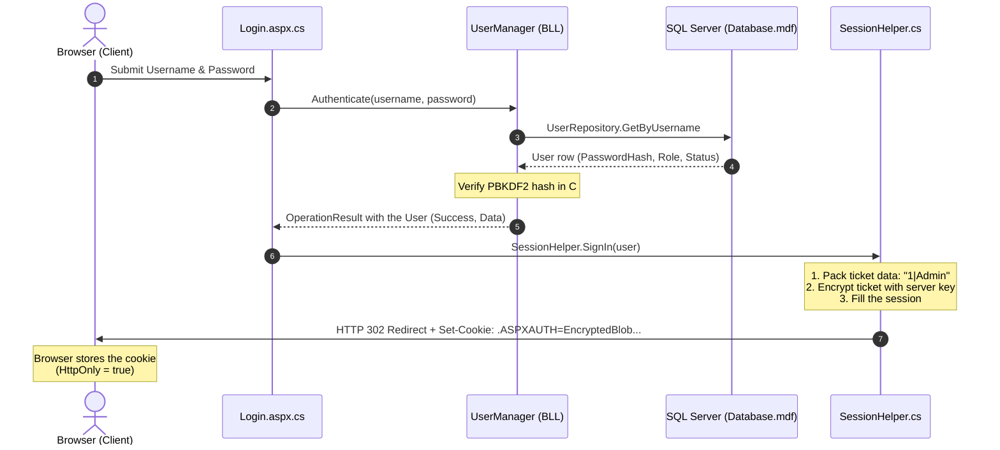
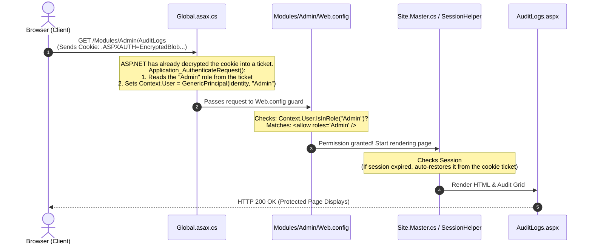

# CodeLab

> **Platform**: ASP.NET Web Forms Web Application (.NET Framework 4.7.2)  
> **Development Database**: LocalDB (`(LocalDB)\MSSQLLocalDB`)

CodeLab is an interactive learning and quiz platform built with ASP.NET Web Forms, structured with a 3-tier architecture (Presentation, Business Logic, and Data Access Layers).

---

## Getting Started

### 1. Prerequisites
* **Visual Studio 2022** (with *.NET desktop development* and *ASP.NET and web development* workloads).
* **SQL Server Express LocalDB** (included with Visual Studio).
* `sqlcmd` available on your `PATH`.

### 2. Create the database
Run `CodeLab\App_Data\SetupDatabase.cmd`. It creates `Database.mdf` in LocalDB and runs `Schema.sql` and `Seed.sql`. To rebuild, delete `Database.mdf` and `Database_log.ldf` first.

The seed creates one account per role (development only, the passwords are public): `admin / Admin@123`, `tutor / Tutor@123`, `learner / Learner@123`.

---

## Authentication & Cookie Architecture

Security is enforced at two distinct boundaries:
1. **URL & Folder Authorization**: Scoped `Web.config` files in `Modules/` folders (`<allow roles="..." />` then `<deny users="*" />`) are checked against `Context.User`, which `Global.asax.cs` fills with the role from the login cookie.
2. **Business Logic Layer**: BLL managers (for example `AuditManager`, `TutorManager`, `CourseManager`) call `SessionHelper.IsUserInRole(...)` before performing role-specific actions.

### How Cookies & Sessions Work Together

* **Forms Authentication Cookie**: The security authority. Holds the encrypted ticket with the username and `UserData` (`UserID|Role`). ASP.NET validates it on every request; `Global.asax.cs` then reads the role from the ticket so the folder `Web.config` rules can use it.
* **Session State**: Fast server-memory cache of `UserID`, `Username`, `FullName` and `Role`, read through `SessionHelper`. If the session is lost while the cookie is still valid, it is rebuilt from the cookie ticket (the full name is reloaded from the database).
* Both the cookie (`<forms timeout="60">`) and the session (`<sessionState timeout="60">`) last 60 minutes; the cookie slides.

```text
┌────────────────────────────────────────────────────────┐
│  FormsAuthenticationTicket                             │
├─────────────────┬──────────────────────────────────────┤
│ Name            │ "admin_user"                         │
│ Issue Date      │ 2026-10-14 17:45:00                  │
│ Expiration Date │ 2026-10-14 18:45:00 (60 min timeout) │
│ UserData        │ "1|Admin"  <-- (UserID | Role)       │
│ CookiePath      │ "/"                                  │
└─────────────────┴──────────────────────────────────────┘
                           │
                 [ Encrypted by Server ]
                           ▼
          .ASPXAUTH = 8F3D9A1B4C7E... (HttpOnly)
```

The cookie is only marked `Secure` (HTTPS-only) when `requireSSL="true"` is set on the `<forms>` element. It is off by default so login works over `http://localhost`; turn it on for production (see below).

### 1. Cookie Generation at Login



### 2. Request Authorization Flow



### Known limitations and production checklist

* **Logout does not revoke copied cookies.** Forms authentication is stateless: a copy of the cookie saved before logout is still accepted until it expires (60 minutes).
* **Nothing re-checks the database after login.** Suspending a user will not log them out until their cookie expires. If an admin "suspend" feature is added, add a status check per request in `Global.asax.cs`.
* **Role changes need a new login.** The role lives in the cookie ticket, so a changed role only applies after the user signs in again.
* **Set `requireSSL="true"`** on the `<forms>` element (for example with a `Web.Release.config` transform) and serve the site over HTTPS in production.

---

## Directory Structure

```text
CodeLab/                          # Repository root
├── README.md                     # Project overview and quickstart
├── CONTRIBUTING.md               # Detailed architectural & coding rules
└── CodeLab/                      # Visual Studio Web Application Project
    ├── App_Data/                 # Database scripts & SetupDatabase.cmd
    ├── App_Start/                # RouteConfig & BundleConfig
    ├── Models/                   # Plain Old CLR Objects (POCOs)
    ├── DAL/                      # Data Access Layer (ADO.NET SQL queries)
    ├── BLL/                      # Business Logic Layer
    ├── Helpers/                  # Cross-cutting static utilities (SessionHelper, etc.)
    ├── Content/                  # CSS design tokens & Bootstrap
    ├── Scripts/                  # Client-side JavaScript
    ├── Modules/                  # Role-based feature pages
    │   ├── Admin/                # Admin only (AuditLogs)
    │   ├── Tutor/                # Tutor & Admin (CourseEditor, LessonEditor, QuizEditor, ChallengeEditor, Profile, ...)
    │   ├── Learner/              # Learner only (Dashboard, Courses, Curriculum, Discussion pages, ...)
    │   └── Public/               # Anonymous (Login, Register, Courses, CourseDetails)
    ├── UserControls/             # Reusable ASCX components
    ├── Site.Master               # Shared application layout
    └── Web.config                # Root IIS & server configuration
```

For full coding guidelines, database rules, and naming conventions, see [CONTRIBUTING.md](CONTRIBUTING.md).
