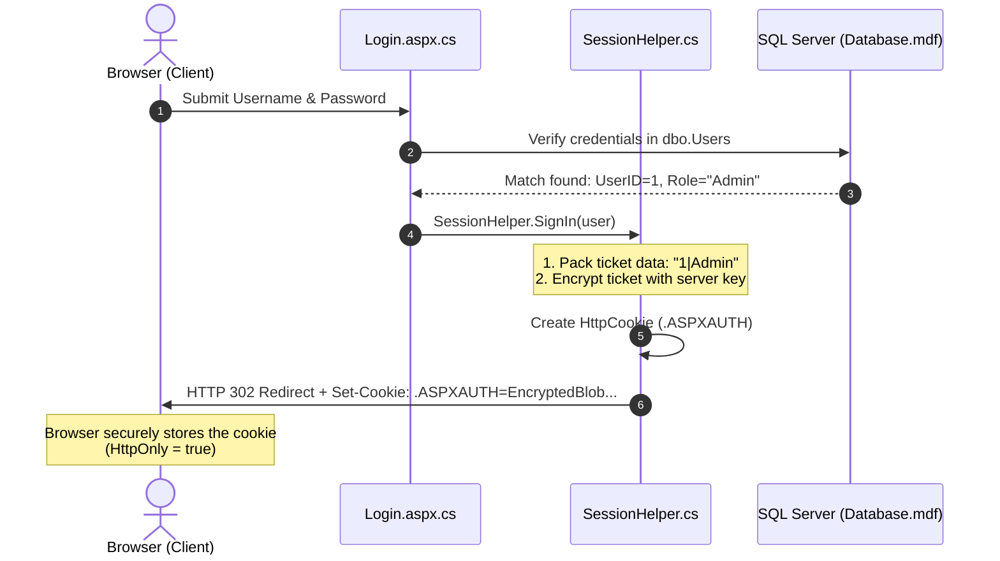
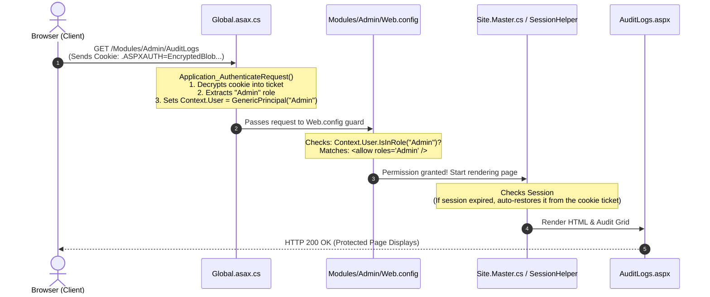

# CodeLab

> **Platform**: ASP.NET Web Forms Web Application (.NET Framework 4.7.2)  
> **Development Database**: LocalDB (`(LocalDB)\MSSQLLocalDB`)

CodeLab is an interactive learning and quiz platform built with ASP.NET Web Forms, structured with a 3-tier architecture (Presentation, Business Logic, and Data Access Layers).

---

## Getting Started

### 1. Prerequisites
* **Visual Studio 2022** (with *.NET desktop development* and *ASP.NET and web development* workloads).
* **SQL Server Express LocalDB** (included with Visual Studio).
* `sqlcmd` available on your `PATH`.


---

## Authentication & Cookie Architecture

Security is enforced at two distinct boundaries:
1. **URL & Folder Authorization**: Scoped `Web.config` files in `Modules/` folders inspect `Context.User`.
2. **Business Logic Layer**: `SessionHelper.IsUserInRole(...)` checks before performing database actions.

### How Cookies & Sessions Work Together

* **Forms Authentication Cookie**: The security authority. Holds the encrypted ticket with `UserID` and `Role`. Checked by `Web.config` on every request.
* **Session State**: Fast server-memory cache for user display info (`FullName`, `Username`). If the session expires, it is automatically restored from the cookie ticket.

```text
┌────────────────────────────────────────────────────────┐
│  FormsAuthenticationTicket                             │
├─────────────────┬──────────────────────────────────────┤
│ Name            │ "admin_user"                         │
│ Issue Date      │ 2026-10-14 17:45:00                  │
│ Expiration Date │ 2026-10-14 18:45:00 (60 min timeout) │
│ UserData        │ "1|Admin"  <-- (UserID | Role)       │
│ CookiePath      │ "/"                                  │
└─────────────────┴──────────────────────────────────────┘
                           │
                 [ Encrypted by Server ]
                           ▼
          .ASPXAUTH = 8F3D9A1B4C7E... (HttpOnly, Secure)
```

### 1. Cookie Generation at Login



### 2. Request Authorization Flow



---

## Directory Structure

```text
CodeLab/                          # Repository root
├── README.md                     # Project overview and quickstart
├── CONTRIBUTING.md               # Detailed architectural & coding rules
└── CodeLab/                      # Visual Studio Web Application Project
    ├── App_Data/                 # Database scripts & SetupDatabase.cmd
    ├── App_Start/                # RouteConfig & BundleConfig
    ├── Models/                   # Plain Old CLR Objects (POCOs)
    ├── DAL/                      # Data Access Layer (ADO.NET SQL queries)
    ├── BLL/                      # Business Logic Layer
    ├── Helpers/                  # Cross-cutting static utilities (SessionHelper, etc.)
    ├── Content/                  # CSS design tokens & Bootstrap
    ├── Scripts/                  # Client-side JavaScript
    ├── Modules/                  # Role-based feature pages
    │   ├── Admin/                # Admin only (AuditLogs, Dashboard)
    │   ├── Tutor/                # Tutor & Admin (ConfigureQuiz)
    │   ├── Learner/              # Learner, Tutor, Admin (CodeLab playground)
    │   └── Public/               # Anonymous (Login, Register)
    ├── UserControls/             # Reusable ASCX components
    ├── Site.Master               # Shared application layout
    └── Web.config                # Root IIS & server configuration
```

For full coding guidelines, database rules, and naming conventions, see [CONTRIBUTING.md](file:///d:/ASP%20Workspace/CodeLab/CONTRIBUTING.md).
